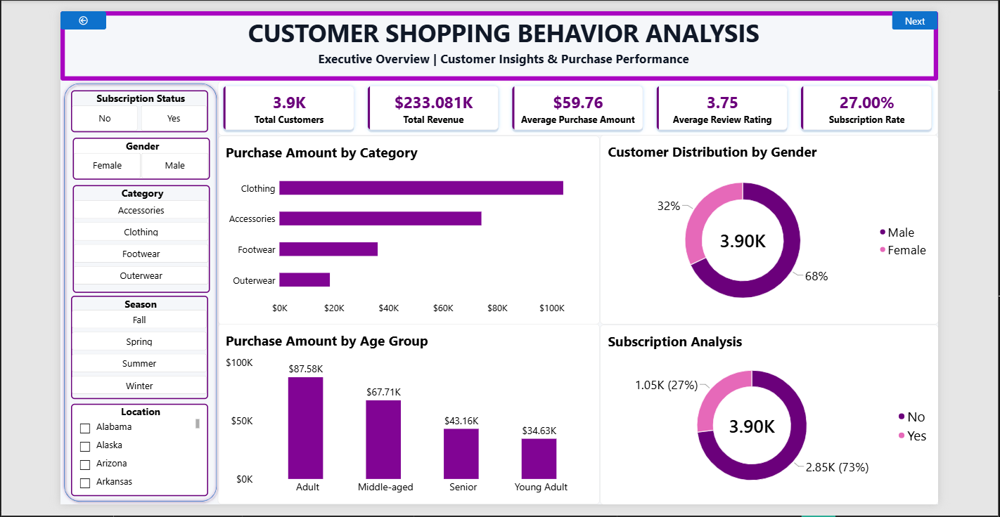
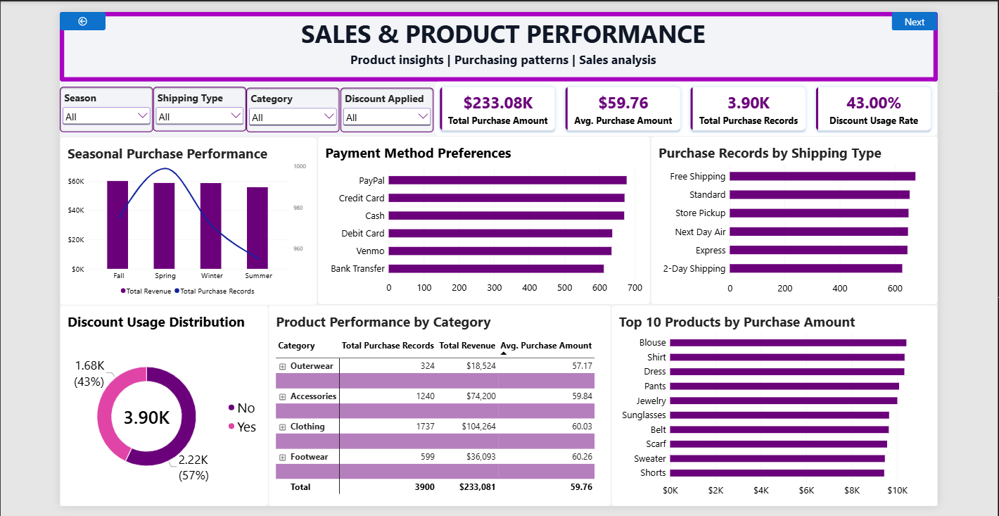
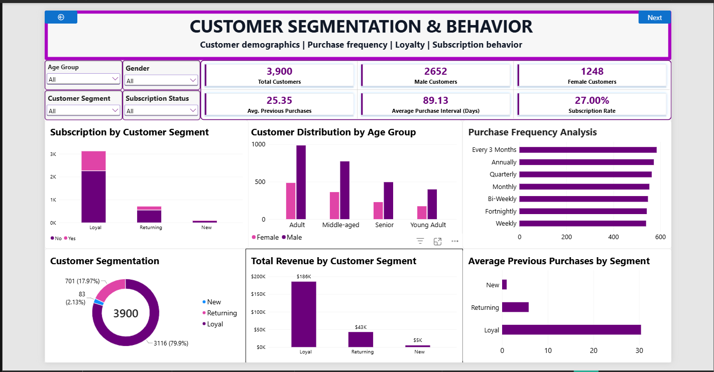
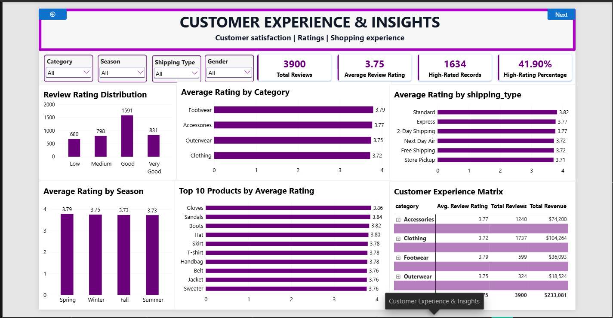

# Customer Shopping Behavior Analysis

An end-to-end data analytics portfolio project exploring customer shopping patterns, product performance, customer segments, and review ratings using **Python, MySQL/MariaDB, SQL, and Power BI**.

## Project at a glance

- **3,900** purchase records
- **18** original dataset columns
- **4** interactive Power BI report pages
- **20** business analysis questions in SQL

## Business objectives

- Understand purchase patterns across product categories, seasons, payment methods, and shipping types.
- Examine customer segments, subscription status, and purchasing frequency.
- Compare discounted and non-discounted purchases.
- Explore review ratings across categories, seasons, shipping types, and products.
- Communicate results through an interactive Power BI dashboard.

## Tools and technologies

| Tool | Purpose |
|---|---|
| Python, Pandas | Data inspection, cleaning, and feature engineering |
| SQLAlchemy, PyMySQL | Python-to-database connection and data transfer |
| MySQL / MariaDB | Store prepared data and run SQL analysis |
| Power BI Desktop | Interactive dashboards and visual analysis |
| Jupyter Notebook | Reproducible preparation workflow |

## Repository structure

```text
Customer-Shopping-Behavior-Analysis/
├── data/
│   └── raw/
│       └── customer_shopping_behavior.csv
├── notebooks/
│   └── Customer_Shopping_Behavior_Analysis.ipynb
├── sql/
│   └── customer_behavior_sql_queries.sql
├── powerbi/
│   └── Customer_Behavior_Analysis_Dashboard.pbix
├── presentation/
│   └── Customer_Shopping_Behavior_Analysis_Presentation.pptx
├── dashboard-screenshots/
│   ├── executive-overview.png
│   ├── sales-product-performance.png
│   ├── customer-segmentation-behavior.png
│   └── customer-experience-insights.png
├── requirements.txt
├── .gitignore
└── README.md
```

## Project workflow

### 1. Data preparation with Python

The notebook loads the CSV into Pandas, inspects the data, cleans column names, handles missing review ratings, creates analytical fields, and loads the prepared data into MySQL/MariaDB.

Preparation steps include:

- Identified **37 missing values** in `review_rating` and imputed them using the median rating within each product category.
- Standardized column names to lowercase snake_case and renamed `purchase_amount_(usd)` to `purchase_amount`.
- Found `discount_applied` and `promo_code_used` identical across all 3,900 records; removed the redundant `promo_code_used` column.
- Created `age_group` using the age bands defined in the notebook.
- Mapped purchase-frequency labels to approximate day intervals in `purchase_frequency_days`.

### 2. Database and SQL analysis

The prepared data is loaded into database `customer_behavior_analysis`, table `customer_data`, using SQLAlchemy and PyMySQL. The SQL script contains business questions covering customer spending, products, revenue, discounts, purchase frequency, and ratings.

### 3. Power BI dashboard

The Power BI report contains four pages with page-specific slicers and page navigation:

1. **Executive Overview** – high-level customer and shopping KPIs.
2. **Sales & Product Performance** – category, seasonal, product, payment, shipping, and discount analysis.
3. **Customer Segmentation & Behavior** – customer segments, age groups, subscription status, and purchase frequency.
4. **Customer Experience & Insights** – rating distribution and rating comparisons across categories, seasons, shipping types, and products.

## Dashboard previews

### Executive Overview



### Sales & Product Performance



### Customer Segmentation & Behavior



### Customer Experience & Insights



## Customer segmentation definition

The report segments records using `previous_purchases`:

- **New:** `previous_purchases = 1`
- **Returning:** `previous_purchases` from 2 to 10
- **Loyal:** `previous_purchases > 10`

**Interpretation:** “New” is the project's defined label for customers with exactly one previous purchase. It is not evidence that they are first-time customers.

## Data quality and interpretation notes

- The source dataset contains 3,900 rows and 18 original columns.
- The original `review_rating` field had 37 missing values before category-median imputation.
- `purchase_frequency_days` is a mapped interval based on frequency labels, not an observed elapsed time between dated transactions.
- The analysis is descriptive; observed differences should not be interpreted as proof of causation.

## Run the project

### Prerequisites

- Python 3.10 or later (or a compatible Python environment)
- Jupyter Notebook
- MySQL or MariaDB server
- Power BI Desktop to open the `.pbix` report

### 1. Clone the repository

```bash
git clone <YOUR_GITHUB_REPOSITORY_URL>
cd Customer-Shopping-Behavior-Analysis
```

### 2. Install Python dependencies

```bash
pip install -r requirements.txt
```

### 3. Create the database

Start your local MySQL/MariaDB service and run:

```sql
CREATE DATABASE customer_behavior_analysis;
```

### 4. Configure database connection

The notebook reads optional connection settings from environment variables. Set these for your own machine before running the database section:

- `MYSQL_USER`
- `MYSQL_PASSWORD`
- `MYSQL_HOST` (default: `localhost`)
- `MYSQL_PORT` (default: `3306`)
- `MYSQL_DATABASE` (default: `customer_behavior_analysis`)

Do not commit passwords, `.env` files, or other credentials to GitHub. Update the notebook's CSV path if you run it from a different working directory; the dataset is stored under `data/raw/` in this repository.

### 5. Run the notebook and SQL script

Open `notebooks/Customer_Shopping_Behavior_Analysis.ipynb`, run the preparation steps, and load the resulting `customer_data` table. Then execute `sql/customer_behavior_sql_queries.sql` against that table.

### 6. Open the Power BI report

Open `powerbi/Customer_Behavior_Analysis_Dashboard.pbix` in Power BI Desktop. If you need to refresh the report on another computer, configure the data source for your own MySQL/MariaDB environment.

## Dataset

The project uses the **Customer Shopping Behavior** dataset from Kaggle. The CSV is included in `data/raw/` for reproducibility. Before making the repository public, verify the dataset's Kaggle license and redistribution terms; if redistribution is not permitted, remove the CSV from the repository and add instructions/link for users to obtain it from the original source.

## Presentation

A project presentation is available at `presentation/Customer_Shopping_Behavior_Analysis_Presentation.pptx`.

## Future improvements

- Add a refreshable, parameterized data pipeline.
- Explore cohort analysis and customer lifetime value if suitable customer-level transaction history becomes available.
- Add automated data-quality checks and a documented KPI dictionary.
- Publish a shareable Power BI version where licensing and data privacy permit.

## Author

**Sachin Vanzare**  
Data Analytics | Python | SQL | Power BI

---

*Created for learning, portfolio development, and demonstrating an end-to-end analytics workflow.*
